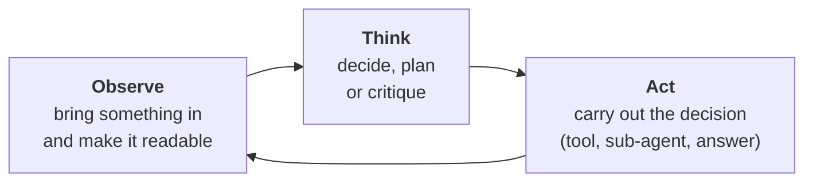

# 02 · Agent Runtime

> One small runtime that runs ReAct, Plan & Execute, ReWOO, LLM Compiler, Reflexion, Debate,
> Tree of Thoughts and more, without hardcoding any of them.

Agent patterns are usually taught as a catalogue of unrelated architectures. This chapter shows
they aren't. Each pattern is the same few parts arranged in a different loop. The runtime just
walks the loop it's given.

**Contents:** [The idea](#the-idea-in-one-picture) · [What you'll learn](#what-youll-learn) ·
[Notebooks](#notebooks) · [Key ideas](#key-ideas) · [Patterns](#the-patterns) ·
[Modules](#modules) · [How it connects](#how-it-connects) · [Running it](#running-it)

---

## The idea in one picture

Every agent does three things, in some order:



| Part | Its only job | Never does |
|---|---|---|
| **Observe** | Turns a user message or a raw tool result into something the conversation can read | Decide anything |
| **Think** | Reasons over the conversation and produces a decision, a plan or a critique | Touch the outside world |
| **Act** | Carries out what a Think decided: call a tool, start a sub-agent, finish | Decide anything |

A pattern is a **declared list** of these parts. This is ReAct, from
[`patterns.py`](patterns.py) with the optional arguments left out:

```python
Runtime(
    loop=[
        Observe(event=request),          # read the request once
        Think(tools=tools),              # decide the next step
        Act(functions=functions),        # do it
        Observe(),                       # read what happened
    ],
    repeat_from=1,                       # loop back to Think
)
```

`runtime.py` never knows which pattern it's running. It doesn't even import `Observe`, `Think` or
`Act`. All it needs is that each item in the loop has a `.run(conversation)` method. This one rule,
"a component is anything with `.run(conversation)`", is what memory, context and MCP plug into in
later chapters, without changing this one.

## What you'll learn

- What separates an **agent** (a loop that decides what runs next) from a **workflow** (a fixed
  pipeline)
- How to split a tool-calling loop into Observe / Think / Act, and why raw tool output never goes
  straight into the conversation
- How to stop a run safely: budgets, **doom-loop detection**, and a graceful final answer
- Two ways an agent notices it went wrong and tries again: repairing tool arguments, and
  reflecting on an answer
- Two kinds of plan, a plan of **tool calls** (a dependency graph) and a plan of **goals**
- Sub-agents: when delegating is worth its cost, splitting a budget, debate and self-consistency
- Ten named patterns as declared loops, and what this design *can't* express

## Notebooks

| # | Notebook | What it shows |
|---|---|---|
| 1 | [`01_workflows_vs_agents`](notebooks/01_workflows_vs_agents.ipynb) | A workflow expects a fixed shape at every step; an agent decides what runs next from what it actually sees |
| 2 | [`02_the_agent_loop`](notebooks/02_the_agent_loop.ipynb) | Chapter 1's tool loop pulled apart into `Runtime`, `Observe`, `Think`, `Act`; ReAct as a declared loop; budgets, doom-loop detection and a graceful stop |
| 3 | [`03_retries_and_reflection`](notebooks/03_retries_and_reflection.ipynb) | `DebugThink` repairs tool arguments out of the conversation's sight; `ReflectionThink` critiques an answer without writing one; `Loop` |
| 4 | [`04_planning`](notebooks/04_planning.ipynb) | A plan of tool calls, where `$stepN` references *are* the dependency graph, run by `Graph` (plan → graph → replan → answer); then a plan of goals |
| 5 | [`05_sub_agents`](notebooks/05_sub_agents.ipynb) | Delegation as a tool call; a self-contained goal per branch; budget splitting; `persistent` × `broadcast` (including debate); self-consistency; beam search |
| 6 | [`06_agent_patterns`](notebooks/06_agent_patterns.ipynb) | Ten named patterns as declared loops, each citing where it was actually run, and an honest list of what these parts can't express |

## Key ideas

### Patterns are configurations, not architectures
- **ReWOO is LLM Compiler with the loop back removed.** They have the same parts and the same
  cost, but only LLM Compiler can notice it isn't finished and replan.
- **Self-Consistency and Debate have identical parts.** They differ only in two settings:
  whether branches see each other's answers (`broadcast`), and whether they stay alive for
  another turn (`persistent`).

Building one runtime that supports all of them is the real engineering problem. Writing one
hardcoded loop per pattern would hide how closely they are related.

### Raw tool output never lands in the conversation
A tool can return thousands of tokens of JSON. `Observe` turns it into a short observation first.
It copies values exactly, keeps what the tool said about what to do next, and converts nothing.
That last rule came from a real bug, described under [How it connects](#how-it-connects).

### Stopping is a feature
A run has budgets (`max_iterations`, `max_tool_calls`, `max_tokens`, `max_seconds`) and
**doom-loop detection**: the same tool call repeated, the same error twice, or oscillating between
two calls. When either trips, the run doesn't just die. The Think gets one more turn without tools
and answers from what it gathered, saying what it couldn't find.

### A plan of tool calls is a dependency graph
When a planned step needs the output of an earlier step, it writes `$step1`. Those references
*are* the edges of a graph, so `Graph` can run independent steps at the same time and resolve
each reference just before its step runs.

### Threads, not `asyncio.gather`
`Graph` and forking use a `ThreadPoolExecutor`. Notebooks already run an event loop, and library
code that starts its own conflicts with it. The work is blocking network I/O, so threads lose
nothing.

### Tool schemas cost tokens on every call
A single ReAct run measured through the API's own `usage` was 2,466 tokens, and 2,394 of them were
prompt. Every tool's schema is re-sent on every call, and a large schema also makes the model
worse at the *other* tools. That's why `delegate` was cut from 2,898 characters to 1,637, and
`replan` from 1,202 to about 250.

## The patterns

All ten are importable factories in [`patterns.py`](patterns.py). A factory fixes the settings
that must be right (measured failures) and exposes only real choices.

| Pattern | Factory | The loop in one line |
|---|---|---|
| ReAct | `react` | Think → Act → Observe, repeat |
| Plan & Execute | `plan_and_execute` | Plan goals once, then a ReAct loop works toward them, able to replan |
| ReWOO | `rewoo` | Plan every tool call, run them as a graph, answer once; no replanning |
| LLM Compiler | `llm_compiler` | ReWOO plus a loop back: plan → graph → replan → answer |
| Self-Refine | `self_refine` | Answer, critique, refine, for a set number of rounds |
| Reflexion | `reflexion` | Attempt, reflect on what went wrong, attempt again |
| Self-Consistency | `self_consistency` | Several independent branches answer; combine them |
| Debate | `debate` | Branches that see each other's answers, over several turns |
| Tree of Thoughts | `tree_of_thoughts` | Expand thoughts, score them, keep the best (beam search) |
| Graph of Thoughts | `graph_of_thoughts` | Like Tree of Thoughts, with more than one parent per thought |

## Modules

Built step by step as the notebooks needed them. No code was written before something proved it
was needed.

| File | What's in it |
|---|---|
| [`runtime.py`](runtime.py) | `Runtime` (the declared loop, `repeat_from`, budgets, doom-loop detection, graceful stop), `Loop` (a bounded inner cycle), `Graph` (runs a plan by its dependencies) |
| [`observe.py`](observe.py) | `Observe`: raw effect → observation, by a deterministic extractor or an LLM; merges branch results; resolves `$stepN` |
| [`think.py`](think.py) | `Think` (tool call, delegation or answer), `PlannerThink`, `ReflectionThink`, `SelectThink`, `ExpandThink`, and `DebugThink`, which repairs arguments and is deliberately *not* a loop component |
| [`act.py`](act.py) | `Act`: runs `respond`, `tool_call`, `fork`, `advance_branch` and `prune` decisions. `execute()` is pure, so `Graph` can call it from several threads |
| [`patterns.py`](patterns.py) | The ten patterns as factories |

## How it connects

**Builds on `01_foundations`.** Almost nothing is new. Chapter 1's `asend_with_tools()` loop
becomes `Runtime`. `execute_tool_call()` runs inside `Act` unchanged. `extract()` produces every
structured decision (`Plan`, `Reflection`, `Selection`). `count_tokens()` now decides when to
*stop* rather than what to drop.

**Changed later, by chapters that found a bug:**

| Change | Found by | What went wrong |
|---|---|---|
| `Observe` keeps what a tool says to do next | `03_tools` | "No weather station for Vestby. Try a larger nearby city." was being summarized down to its first half, so the model never saw the suggestion |
| `Observe` must not change a value | `03_tools` | Asked for Fahrenheit, `Observe` converted 20 °C to 68 °F itself. The calculator tool was never called, and the arithmetic appears in no tool result |
| `render()` writes the tool's name as well as its arguments | `05_context` | Two different tools called with the same arguments rendered as the same line |

**Used by every later chapter.** Memory (`04`), context (`05`) and MCP reconnection (`07`) each
arrive as a new component in the loop, and none of them needed a change here.

## Which model the outputs came from

Most of this chapter was built against **`llama-3.3-70b-versatile`**, and the saved outputs were
re-run on **`openai/gpt-oss-120b`**. Under a large schema, llama-3.3 sometimes wrote a tool call as
plain *text* (`<function=delegate{...`), which the API rejects. gpt-oss-120b doesn't do this, so the
schema-trimming work can look unnecessary now. It is still the right size, because schema tokens
are paid on every call.

## Running it

```bash
conda activate agentic-forge
# .env needs GROQ_API_KEY
```

Notebook 5's forking demos can use a large share of Groq's 100k-tokens-a-day free tier in one run.
That's a quota limit, not a bug; run it again the next day.

## Going deeper

[`NOTES.md`](NOTES.md) has the full write-up, including a table of every chapter 1 primitive and
what this chapter does with it.
