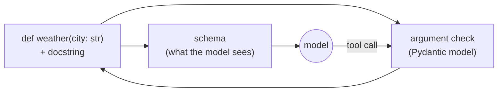

# 03 · Tools

> Everything between "the model asked to call something" and "a result came back": defining a
> tool, describing it, holding many of them, calling one safely, and checking it did its job.

Chapters 1 and 2 used two hand-written tools. This chapter is about what changes once you have
*many* tools, written by different people, that fail in different ways.

**Contents:** [The idea](#the-idea-in-one-picture) · [What you'll learn](#what-youll-learn) ·
[Notebooks](#notebooks) · [Key ideas](#key-ideas) · [Modules](#modules) ·
[How it connects](#how-it-connects) · [Running it](#running-it)

---

## The idea in one picture

A hand-written tool states the same fact three times, and nothing keeps the three in step:

```
  def weather(city: str)        the function
  {"name": "weather", ...}      the JSON schema the model reads
  class WeatherArgs(...)        the check on the arguments that come back
```

Rename a parameter in the function and the check still passes, until the call crashes. The check
is one of the three copies that went stale, so it can't catch the others.

**The fix is to write it once and work out the rest.** The function's signature is the one copy
that can't go stale, so both the schema and the argument check are generated from it:



## What you'll learn

- How `@tool` builds the model's JSON and the argument check from one function signature
- How a **registry** holds many tools: name clashes, prefixes, subsets, and what 30 tools cost in
  tokens on *every* turn
- What happens at the moment of the call: time limits, size limits, and sorting failures by **who
  can act on them**
- Why "the tool returned" is not the same as "the tool did its job", and how to check the world
  afterwards
- A standard toolbox (HTTP, files confined to one folder, a safe calculator) tested against things
  that don't cooperate

## Notebooks

| # | Notebook | What it shows |
|---|---|---|
| 1 | [`01_what_is_a_tool`](notebooks/01_what_is_a_tool.ipynb) | A renamed parameter breaks a working tool; then `args_model()` and `@tool`, which build the check and the schema from the signature, with `Annotated` descriptions and `extra="forbid"` |
| 2 | [`02_the_registry`](notebooks/02_the_registry.ipynb) | A plain dict silently keeping one of two `search` tools; prefixes; what the API accepts as a name; the token cost of thirty tools; subsets by name and tag |
| 3 | [`03_invocation`](notebooks/03_invocation.ipynb) | A tool that hangs (and why chapter 2's time budget can't stop it); failures sorted by who can fix them; a 7,601-token result cut to size; a timeout on a tool that must not run twice |
| 4 | [`04_verification`](notebooks/04_verification.ipynb) | A tool that saves 60 characters of a 110-character note and reports success; `verified()`, which checks the world instead of the tool's own answer |
| 5 | [`05_built_in_tools`](notebooks/05_built_in_tools.ipynb) | Real 404s, a dead host and a 7,254-token response; file tools locked to one folder; a calculator that isn't `eval`. Also catches `Observe` doing the agent's arithmetic itself |

## Key ideas

### Every call ends in one of six ways
`invoke()` never raises. It returns a `Result` whose `kind` says what happened, so the loop can
decide what the model should see and whether trying again is safe:

| Kind | What happened | Does the model see the details? |
|---|---|---|
| `ok` | The tool did its job | Yes |
| `bad_arguments` | The arguments failed the check | Yes, so it can fix them |
| `refused` | The tool ran and said no (`ToolError`), usually with a suggestion | Yes, including the suggestion |
| `unverified` | It returned, but a check on the world afterwards failed | Yes |
| `timeout` | It ran past its time limit | Yes |
| `broken` | A bug in the tool itself: a missing key, a bad import | **No**, only that it couldn't be done |

### Refused vs broken: who can act on the failure?
A refusal is written *for the model*. `ToolError("No weather station for Vestby. Try a larger
nearby city.")` tells it exactly what to do next. A broken tool is ours to fix, and telling the
model about a `KeyError` only invites it to work around something it can't see.

So when a result is broken, `invoker()` hands the conversation `"<tool> could not be completed."`
and the cause moves to `Result.value`, where whoever is reading the run can still find it. The
model gets a clear message it can act on, and the developer still gets the real error.

### A per-call time limit, because the run's budget can't help
`Runtime(max_seconds=...)` is checked *between* components, so a tool that hangs inside `Act`
blocks it forever. `invoke(timeout=...)` limits each call. If the tool is not `repeatable`, for
example because it sends a payment, `Result.safe_to_retry` says not to try again after a timeout.

### "It returned" is not "it worked"
A note-saving tool truncated a 110-character note to 60 and reported success. Reading the tool's
own reply can't catch that, because the reply is the thing that's wrong. `verified()` wraps a tool
with a check that **looks at the world afterwards** (for a saved note, it reads the note back) and
turns a mismatch into `unverified`.

### A large tool result is cut before it reaches the conversation
A real API response was 7,601 tokens. `invoke(max_tokens=...)` passes the conversation only what
it can carry, and keeps the whole thing on `Result.value`.

## Modules

| File | What's in it |
|---|---|
| [`tools.py`](tools.py) | `args_model()` (signature → Pydantic argument check), `Tool` (the function, its schema and its check), `@tool` |
| [`registry.py`](registry.py) | `Registry`: refuses a duplicate or invalid name; `prefix=` and `merge()` for combining sources; `subset()` by name or tag; `invokers()` to hand tools to chapter 2's `Act` |
| [`invoke.py`](invoke.py) | `invoke()` (one call, with time and size limits, every ending returned as a `Result`), `ToolError`, `truncate()`, `Result.for_the_model`, `Result.safe_to_retry`, and `invoker()`, the adapter into `Act` |
| [`verify.py`](verify.py) | `verified()`, a copy of a tool with a check on the world wrapped around it, and `VerificationError` |
| [`toolbox.py`](toolbox.py) | `http_get`, `file_tools(root)` confined by `within()`, `written_correctly(root)`, and `calculate()`, which walks parsed expressions instead of calling `eval` (not named `builtins.py`, which would shadow Python's own) |

## How it connects

**Builds on chapters 1 and 2 without changing their wiring.** Tools feed chapter 2's `Act`
through `Registry.invokers()`, and chapter 1's `execute_tool_call()` still runs every call.

| Before | Now |
|---|---|
| Tool JSON typed by hand (ch. 1) | Built from the signature, so it can't disagree with the function |
| `except Exception: "Error: {e}"` (ch. 1) | Split by who can act on it: the model, or us |
| A call that returns = success (ch. 1) | `verified()` checks the world |
| `str(result)` sent in full (ch. 1) | `invoke` sends what fits and keeps the rest on `Result.value` |

**Changed chapter 2.** `Observe`'s prompt had two clauses that caused bugs. It summarized away
the second half of a refusal ("Try a larger nearby city"), and it converted 20 °C to 68 °F itself
instead of letting the calculator tool do it. Both clauses are now replaced: `Observe` keeps what
the tool said to do next, and converts or calculates nothing.

**Changed later by `07_mcp`.** `Result.for_the_model` used to be computed and read by nothing, so
a broken result's text still reached the model. That was rare while every tool was local. Over MCP,
`broken` describes any failure a foreign server doesn't explain, so `invoker()` now enforces the
flag.

**Used by** `04_memory` (`remember` and `recall` are ordinary tools), `06_orchestration` (an
agent wrapped as a tool), and `07_mcp` (the same `Tool` built from a remote schema).

## Running it

```bash
conda activate agentic-forge
# .env needs GROQ_API_KEY
```

Notebook 5 makes real HTTP requests, including to hosts that don't exist, on purpose.

## Going deeper

[`NOTES.md`](NOTES.md) has the full write-up of every finding and every change to earlier
chapters.
