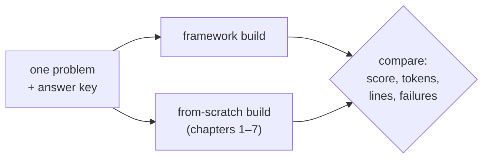

# 08 · Frameworks

> Eight agent frameworks (LangChain, LangGraph, CrewAI, AutoGen, LlamaIndex, Mem0, LangSmith and
> Langfuse), each learned by building one small, working, production-minded project with it.

Chapters 1–7 built every part from scratch: the model call, the agent loop, tools, memory,
context, orchestration and MCP. That's what makes a framework readable. Every abstraction it
offers is something this repo has already built once, so the questions become concrete:

- What did the framework do for us?
- What did we still have to write?
- What did it hide?
- What did it cost?

**Contents:** [The idea](#the-idea) · [Projects](#projects) · [What we found](#what-we-found) ·
[Across all eight](#lessons-across-all-eight) · [Versions](#versions-and-installing-them) ·
[Running it](#running-it)

---

## The idea

Wherever it applies, the same project is built **twice**: once with the framework, and once from
this repo's own parts. Both builds get the same problem, the same prompts and the same answer key,
so the only difference between them is the framework.



### How each project folder is laid out

| File | Purpose |
|---|---|
| `<project>.ipynb` | Two parts. **Build**: what the project is, with key functions shown from the modules so they can't drift. **Run and show**: offline against stand-ins, then live, then the scratch build on the same inputs, and the findings |
| `*.py` modules | The system itself, framework build and scratch build |
| `*_stubs.py` | Stand-ins for every model call, so the system can be tested for free |
| `*_checks.py` | Framework behaviours worth knowing, each reproduced as a function |
| `test_*.py` | Offline tests that cost nothing to run |

## Projects

| Folder | Framework | What it's for | Project | Scratch build |
|---|---|---|---|---|
| [`01_langchain`](01_langchain/) | LangChain | building blocks | **Meridian's claims assistant**: answers travel-insurance customers from the policy wording and their account | yes |
| [`02_langgraph`](02_langgraph/) | LangGraph | stateful orchestration | **Kestrel Labs' accounts-payable desk**: invoices matched, routed, investigated, and held for people for days | yes |
| [`03_crewai`](03_crewai/) | CrewAI | role-and-task teams | **Tallyfold's security questionnaire**: three specialists answer in parallel from a policy pack, a lead assembles | yes |
| [`04_autogen`](04_autogen/) | AutoGen | agents in conversation | **Brightwater's analysis team**: a planner, an analyst that runs pandas, a reviewer and a reporter, on an export with two planted problems | yes |
| [`05_llamaindex`](05_llamaindex/) | LlamaIndex | knowledge and retrieval | **Ask the cookbook**: answers questions about *this repo* with citations | the agent only |
| [`06_mem0`](06_mem0/) | Mem0 | memory | **A running coach that remembers**: two runners, nine weekly check-ins, facts that keep changing | yes |
| [`07_langsmith`](07_langsmith/) | LangSmith | evaluation | **Evaluating the cookbook assistant**: a 10-question dataset, a checked claim-by-claim judge, fixes driven by traces | — |
| [`08_langfuse`](08_langfuse/) | Langfuse | observability | **The cookbook assistant in production**: every step traced, a cost on every call, prompt versions, metrics | — |

## What we found

### 01 · LangChain
- **Both builds scored 5 of 8 at the same cost**, and made the same real mistake. Each replied
  correctly in prose that a delay was already paid, while its structured fields said to pay it
  again. That became a rule in code.
- A chain gives the model one turn, and this model calls one tool per turn (15 of 15).
- `with_structured_output(method="json_schema")` silently becomes a tool call on non-OpenAI model
  classes. Groq doesn't stream JSON replies, so the reply streams as prose first and fields after.
- LangChain 1.x has deprecated both of its memory classes in favour of LangGraph.

### 02 · LangGraph
- **Both builds handled all seven invoices as policy requires** (19,778 vs 22,874 tokens; 267 vs
  263 lines). Pausing for days, resuming in another process, surviving a crash and rewinding all
  worked first time.
- The scratch build is a different design: a **case file** on chapter 6's shared board, where a
  step that needs a person *ends* rather than being re-run. It refuses an approval from the wrong
  person; the graph records that approval as the right person's. Rewind-and-fork is what it gives
  up.
- Five behaviours to know before production, each reproduced offline:
  - a resumed node runs again **from its first line**, so an email sent before `interrupt()` is
    sent twice;
  - answers to `interrupt()` are matched by **position**, so a deploy that reorders them swaps
    the answers;
  - the default step limit is **10,007**;
  - a loop through `interrupt()` is never stopped by it;
  - retry layers multiply.
- Found live: a tool call the provider refuses ends the run.

### 03 · CrewAI
- **The sequential crew scored 9 of 9** on a questionnaire with five traps (17,632 tokens). The
  hierarchical crew and the scratch build scored 8 of 9 each, both missing the same label.
- CrewAI 0.193 describes tools in the prompt and parses text back. gpt-oss-120b, trained to call
  tools natively, made a refused call, then answered without reading anything and cited ids it had
  invented. So this project runs on **qwen3.8-27b**.
- A failure inside a parallel (`async_execution`) task makes the crew **wait forever**, so runs
  get a deadline. LiteLLM's retries gave up on qwen's 1,000-output-tokens-a-minute limit, so 429s
  are waited out.
- CrewAI describes forms to the model without their allowed values or field descriptions, and
  sends telemetry by default.

### 04 · AutoGen
- **Without help, both builds got Q1 wrong the same way.** The 70 duplicated orders were never
  dropped, and both reviewers approved. Given nine generic **procedures as skills** (three
  relevant), both got it right.
- AutoGen billed 56,624 tokens against the scratch build's 44,350, but its own messages report
  only 36,682. That's why `TokenUsageTermination` can't enforce a budget: the limit has to live in
  the model client.
- Its code executor hands model-written code **every API key in the environment**. It doesn't
  run inside a Jupyter kernel on Windows, and the code and its output never reach the other agents.

### 05 · LlamaIndex
- **The one-shot engine answered all 15 questions** with the right word and a cited file (48,093
  tokens), and turned away all 3 off-topic questions before calling a model. The refusal floor has
  a thin margin (0.702 vs 0.624), and must be applied to raw vector scores, because after fusion a
  score is rank arithmetic.
- **LlamaIndex's agent re-sends everything it has found on every call.** Its 8th request reached
  8,172 tokens and Groq refused it. The scratch agent (chapter 2's loop with chapter 5 choosing each
  call's context) kept every call near 4,300 tokens and answered both questions, using more tokens
  in total.
- Behaviours to know: with no model set it reaches for OpenAI; a loaded index forgets its
  splitter; `refresh_ref_docs` never removes a deleted file.

### 06 · Mem0
- **What decided the outcome was how memory was written, not the store.** Mem0 writes in a
  separate step after every check-in and caught every fact. The first scratch build wrote memory
  as a side job of replying, and told a runner the **old race date**.
- In 2.2.1, `add` **only adds**; it never updates or deletes, although its docstring says it does.
  By default it also stores the assistant's own advice as memories (10 of 26), which one custom
  instruction removed.
- After seven measured rounds against a 50-fact answer key, the scratch build saved **47 of 50
  facts right, with nothing stale shown**. Mem0 saved 48, but 17% of what it showed the coach had
  already been replaced. Both answered every current-state question right.
- With ~100 extra memories per runner, Mem0's single search let 8 of 14 needed facts through; the
  scratch build got 14 of 14 after `Recall` became hybrid and searched one question at a time.
- Its general fixes went back into chapter 4: `Profile`, `QdrantJournal`, `writing.py` and hybrid
  `Recall`.

### 07 · LangSmith
- **The evaluation loop worked.** There were three rounds on 10 questions, and each fix in `05`
  came from reading a trace: `open_file` names its file, an unparseable reply is retried, every
  request is capped at 6,000 tokens, and the step-limit answer is given what the run found.
- **The judge was checked before it was trusted.** Against 10 hand-marked answers it matched the
  points made, but caught only 2 of 5 wrong claims, with 7 false alarms. So it measures coverage,
  and its error lists are leads for a person.
- The free tiers set the size: one round uses most of a day's Groq tokens. Every result is one
  sample, and a real evaluation needs more questions and repeated runs.
- LangSmith has no LlamaIndex integration of its own, so tracing hooks in at `05`'s seams.

### 08 · Langfuse
- **No code of ours on the spans.** As an OpenTelemetry tracer, Langfuse shows all 165 steps of
  one answer. One price-table entry puts dollars on every call. All of `08` cost about **$0.055**.
- One model call is recorded as **four "generations"**, so counts are four times the calls while
  sums are right.
- Prompt v2 vs v1 (one run each): the same on two questions, 71% → 86% on the one v2 was written
  for, at $0.034 vs $0.021.
- Running for real found two more limits, fixed in `05`: a 300 s timeout too short under the
  per-minute limit (now 900 s), and tool results passed as plain text at the step limit so the
  model answers instead of calling more tools.

## Lessons across all eight

1. **The design decided the score more than the framework did.** LangChain and its scratch build
   tied, both LangGraph builds handled every invoice, and in Mem0 the deciding factor was *when
   memory gets written*.
2. **Check the defaults before production.** Telemetry on by default (CrewAI, Mem0). A silent
   fallback to OpenAI (LlamaIndex). Every API key passed to generated code (AutoGen). `get_all`
   stopping at 20 without saying so (Mem0).
3. **Limits have to live where the calls are made.** Token budgets in AutoGen, step counts in
   LangGraph and memory limits in LlamaIndex each failed to stop what they seemed to promise. A
   count can't tell an agent working hard from one going round in circles.
4. **A framework's dependency pins are part of its cost.** See CrewAI below.
5. **Free tiers shaped real decisions.** The model choice, the judge and the evaluation size were
   all set by free-tier limits.

## Versions, and installing them

All eight frameworks share the repo's single `environment.yml`.

| Framework | Version | Note |
|---|---|---|
| LangChain (`langchain-core`, `langchain-openai`) | 1.6.x | `langchain` itself isn't needed |
| LangGraph | 1.2.12 | |
| CrewAI | **0.193.2** | deliberately old (see below) |
| AutoGen (`autogen-agentchat`, `autogen-ext`) | 0.7.5 | last released 2025-09-30; Microsoft Agent Framework is its successor |
| LlamaIndex (`llama-index-core`) | 0.14.x | |
| Mem0 (`mem0ai`) | 2.2.1 | plus `fastembed` and `spacy` with `en_core_web_sm` |
| LangSmith | 0.14.1 | |
| Langfuse | 4.15.6 | plus `openinference-instrumentation-llama-index` |

**Why CrewAI is pinned to 0.193.2 (September 2025).** Every CrewAI release from 0.201 pins
`chromadb~=1.1`, and from 1.7 also `mcp~=1.28`. Installing a current one would downgrade `mcp`
from 2.2 to 1.28, which breaks `07_mcp`, and `chromadb` from 1.5.9 to 1.1, which `04_memory`'s
store is built on. 0.193.2 is the newest release whose pins fit. The alternative was a second
environment.

The rest installed together with small moves: `protobuf` 7 → 5.29 (AutoGen pins it),
`onnxruntime` 1.29 → 1.22, `websockets` 17 → 16. Chapters 4 and 7 were re-checked afterwards.

## Running it

**API keys** (all listed in `.env.example`):

| Key | Used by |
|---|---|
| `GROQ_API_KEY` | every project: `openai/gpt-oss-120b`, except CrewAI on `qwen/qwen3.8-27b` |
| `GEMINI_API_KEY` | embeddings (as in chapter 4), and Mem0's own model (`gemini-3.5-flash-lite`) |
| `LANGSMITH_API_KEY` | `07_langsmith`; `GEMINI_API_KEY_JUDGE` optionally, for its judge |
| `LANGFUSE_PUBLIC_KEY`, `LANGFUSE_SECRET_KEY`, `LANGFUSE_BASE_URL` | `08_langfuse` |

LangSmith and Langfuse are cloud services, so traces, including prompts and outputs, leave the
machine.

**Offline tests** cost nothing:

```bash
cd 08_frameworks/01_langchain  && python test_claims.py
cd 08_frameworks/02_langgraph  && python test_ap.py
cd 08_frameworks/03_crewai     && python test_questionnaire.py
cd 08_frameworks/04_autogen    && python test_analysis.py
cd 08_frameworks/05_llamaindex && python test_ask.py
cd 08_frameworks/06_mem0       && python test_coach.py
cd 08_frameworks/07_langsmith  && python test_evals.py
cd 08_frameworks/08_langfuse   && python test_ops.py
```

**Notebooks** run on the `agentic-forge` kernel from inside their folder. Live sections spend real
tokens (roughly 20k per build per project) against Groq's daily limit. That's why every project is
tested against stand-ins first, and why a fix re-runs only the cells it touches.

## Going deeper

[`NOTES.md`](NOTES.md) has the full findings for every project, round by round.
