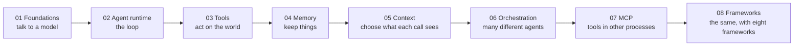

# Agentic Forge Cookbook

> Build agentic AI systems from first principles, one concept per chapter, with every claim
> checked on a real model.


[](LICENSE)

This repo builds a complete agent stack by hand: model calls, the agent loop, tools, memory,
context, multi-agent orchestration and MCP. Then it rebuilds real projects with eight popular
frameworks and compares each against the hand-built version.

**Contents:** [Why this repo](#why-this-repo) · [Learning path](#the-learning-path) ·
[Chapters](#chapters) · [Quick start](#quick-start) · [API keys](#api-keys) ·
[Repository layout](#repository-layout) · [Conventions](#conventions) · [License](#license)

---

## Why this repo

Most agent tutorials start with a framework. This one ends with them.

- **Built, not toured.** Every abstraction a framework offers (a chain, a graph, a crew, a memory
  layer) is first written here from scratch, so by chapter 8 you can see what each framework does
  for you and what it hides.
- **Measured, not asserted.** Findings come from real runs on a real model, with numbers. Where
  one run could be luck, the experiment is repeated (for example, *"obeyed 11 times in 24, and 0
  times in 37"*).
- **Built from real failures.** Most notebooks show something breaking on a real model and then
  build the fix, and later chapters say plainly when they had to change an earlier one.

## The learning path



Chapters build in order, but each one stands on its own and says which earlier pieces it uses.

## Chapters

| # | Chapter | The question it answers | Notebooks | One thing it shows |
|---|---|---|---|---|
| 01 | [Foundations](01_foundations/) | How do I talk to a model at all? | 9 | A schema controls an answer's *shape*, never whether it makes sense, so you still validate |
| 02 | [Agent runtime](02_agent_runtime/) | How does one agent run? | 6 | ReAct, ReWOO, Debate and Tree of Thoughts are the same three parts (Observe, Think, Act) in different loops |
| 03 | [Tools](03_tools/) | How does an agent act safely? | 5 | "The tool returned" is not "the tool worked": a note was truncated and reported as saved |
| 04 | [Memory](04_memory/) | What does it keep, and where? | 5 | Choose the store by the question it will answer; most memories are a dict, not a vector database |
| 05 | [Context](05_context/) | What should each call see? | 6 | Separating instructions from data took prompt injection from 11/24 to 0/37 |
| 06 | [Orchestration](06_orchestration/) | How do *different* agents work together? | 5 | A rule in the supervisor fixed routing 8/8; better agent descriptions fixed it 0/8 |
| 07 | [MCP](07_mcp/) | How do I use tools from other programs, and share my own? | 6 | A tool looks exactly the same over MCP. What changes is that it runs in a separate program, and that program is not a sandbox |
| 08 | [Frameworks](08_frameworks/) | What do frameworks add, hide and cost? | 8 projects | LangChain, LangGraph, CrewAI, AutoGen, LlamaIndex, Mem0, LangSmith and Langfuse, each against a scratch build |

## Quick start

**1. Create the environment** (Python 3.13, conda):

```bash
conda env create -f environment.yml
conda activate agentic-forge
```

**2. Add your keys:**

```bash
cp .env.example .env      # then fill in at least GROQ_API_KEY
```

**3. Open the first notebook** with the `agentic-forge` kernel:

```
01_foundations/notebooks/01_your_first_llm.ipynb
```

Every notebook's outputs are saved, so you can read the whole repo without running anything.
Re-running produces different text; that's expected with a live model.

## API keys

Only Groq is needed to start. The others come in at the chapter that needs them.

| Key | Needed from | Used for |
|---|---|---|
| `GROQ_API_KEY` | chapter 1 | every chat model ([console.groq.com](https://console.groq.com/keys)) |
| `GEMINI_API_KEY` | chapter 4 | embeddings, because Groq serves none ([aistudio.google.com](https://aistudio.google.com/apikey)) |
| `NEO4J_URI`, `NEO4J_USER`, `NEO4J_PASSWORD` | chapter 4, notebook 2 | the graph store; a free instance at [console.neo4j.io](https://console.neo4j.io) |
| `LANGSMITH_API_KEY` | `08_frameworks/07_langsmith` | tracing and evaluation |
| `LANGFUSE_PUBLIC_KEY`, `LANGFUSE_SECRET_KEY`, `LANGFUSE_BASE_URL` | `08_frameworks/08_langfuse` | observability |

**Models and free-tier limits.** The default is `openai/gpt-oss-120b` on Groq. Chapter 6 mostly
uses `gpt-oss-20b`, and CrewAI uses `qwen/qwen3.8-27b`. The free tier has a daily token limit of
about 100k and a per-minute limit (8,000 tokens for gpt-oss-120b). The clients retry per-minute
limits automatically. If you hit the daily limit, wait for the next day. Gemini's free embedding
tier allows about 1,000 texts a day per model.

## Repository layout

```
agentic-forge-cookbook/
├── 01_foundations/          one folder per chapter
│   ├── README.md            overview: the idea, notebooks, key findings, modules
│   ├── NOTES.md             the full write-up: every experiment and design decision
│   ├── notebooks/           the lessons, in order, with saved outputs
│   └── *.py                 the implementation, built as the notebooks needed it
├── 02_agent_runtime/ … 07_mcp/
├── 08_frameworks/           one folder per framework, each a self-contained project
│   └── 01_langchain/ …      modules, one notebook, stand-ins, offline tests
├── environment.yml          the single environment for everything
└── .env.example             every key, with where to get it
```

Start with a chapter's **README** for the idea and the headline results. Read **NOTES.md** for the
reasoning behind each decision.

## Conventions

- **Code follows the notebooks.** A module is written only when a notebook needs it.
- **Later chapters plug into earlier ones instead of rewriting them.** Memory, context and MCP
  each arrive as an ordinary component in chapter 2's loop. When a later chapter did have to
  change an earlier one, its README says what changed and why.
- **Saved outputs are real runs.** Every notebook is committed with the outputs of a live run, so
  the numbers in the READMEs can be checked against them.
- **Results say how many runs they rest on.** Where one run could be chance, the experiment is
  repeated and reported as counts (chapter 5's 0 of 37, chapter 6's 8 of 8). Where free-tier
  quotas allowed only one run, as in chapter 8's evaluations, the README says so.

## Running the offline tests

Only chapter 8 has separate tests. Each project there has stand-ins for every model call
(`*_stubs.py`) and tests that make no API calls (`test_*.py`). Chapters 1–7 have no test files;
their checks run inside the notebooks.

```bash
cd 08_frameworks/01_langchain  && python test_claims.py
cd 08_frameworks/02_langgraph  && python test_ap.py
cd 08_frameworks/03_crewai     && python test_questionnaire.py
cd 08_frameworks/04_autogen    && python test_analysis.py
cd 08_frameworks/05_llamaindex && python test_ask.py
cd 08_frameworks/06_mem0       && python test_coach.py
cd 08_frameworks/07_langsmith  && python test_evals.py
cd 08_frameworks/08_langfuse   && python test_ops.py
```

## License

[MIT](LICENSE) © 2026 Venkat Datta Bommena. You may use, copy, modify and share the code and
notebooks, including commercially, as long as the copyright and license notice are kept.
